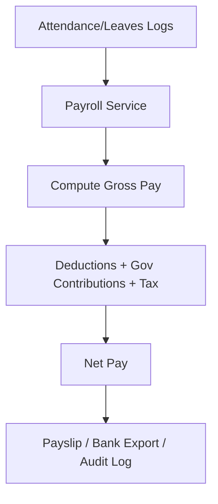

# KryptonHR — System Overview

## Architecture
Browser (frontend) -> FastAPI routers -> services -> repositories -> PostgreSQL
Auth via JWT + RBAC (Admin, HR, Employee).

## Modules
- Auth (login, JWT, RBAC, password policy)
- Employees (profiles, salary bases, classifications)
- Lookups (positions, departments, etc.)
- Attendance (timekeeping, shifts, overtime, night diff, tardiness)
- Leaves (requests, approvals, balances)
- Payroll (gross/net pay, allowances, deductions, SSS/PhilHealth/Pag-IBIG, tax)
- Recruitment (applicants, AI resume parser, hiring)
- QR Attendance (kiosk, QR signing)
- Chatbot/AI (HR/payroll assistant)

## Data Flow (Payroll)

## Access Control
- Admin: full access
- HR: employees, attendance, leaves, payroll view
- Employee: own profile/records only

## Deliverables
Payslips, period summaries, statutory reports, bank export files, audit logs.
